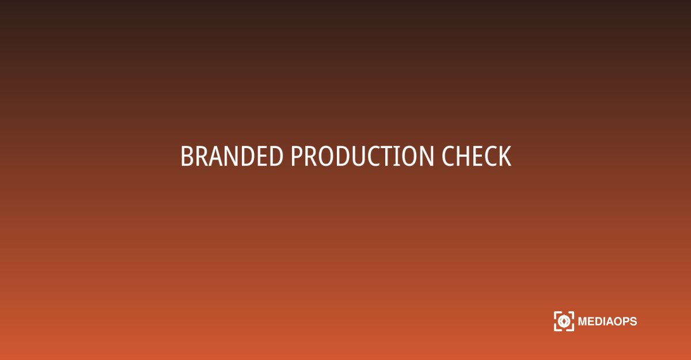
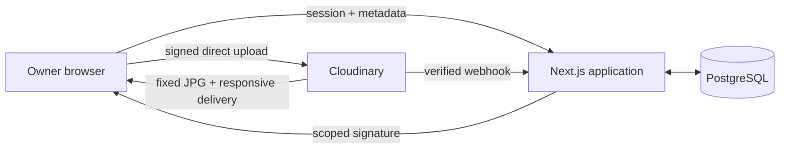

# MediaOps Studio

MediaOps Studio turns one approved event image into four branded, production-ready channel exports and a responsive Cloudinary delivery URL.

**Live deployment:** [mediaops-studio.vercel.app](https://mediaops-studio.vercel.app)



## What it does

A signed-in media owner creates a release, records event metadata, and uploads a JPG, PNG, or WebP directly to Cloudinary. Cloudinary produces four eager JPG derivatives with subject-aware cropping. Verified webhooks update the release; it becomes `READY` only when the master and all required outputs exist.

| Output | Dimensions |
|---|---:|
| Instagram square | 1080 × 1080 |
| Instagram portrait | 1080 × 1350 |
| LinkedIn landscape | 1200 × 627 |
| Story vertical | 1080 × 1920 |

## Architecture



The application owns users, workflow state, template versions, audit events, and manifests. Cloudinary owns the master media, transformations, metadata, and CDN delivery. Image bytes never pass through the application server.

## Local setup

Prerequisites: Node.js 22+, Docker, a Cloudinary product environment, and a signed upload preset.

```bash
cp .env.example .env
docker compose up -d postgres
npm install
npm run db:migrate
npm run db:seed
npm run dev
```

Open `http://localhost:3000` and sign in with `DEMO_EMAIL` and `DEMO_PASSWORD` from `.env`.

For local webhook delivery, expose port 3000 through an HTTPS tunnel and set `CLOUDINARY_WEBHOOK_URL` to the public `/api/webhooks/cloudinary` URL before starting the app.

## Cloudinary setup

Create a **signed** upload preset named `mediaops_release_v1` (or change `CLOUDINARY_UPLOAD_PRESET`) with these restrictions:

- Resource type: image
- Allowed formats: JPG, JPEG, PNG, and WebP
- Unique filenames disabled; overwrite enabled for deterministic master IDs
- The production webhook URL uses HTTPS

Cloudinary upload presets do not support a per-preset file-size cap. The application therefore validates the 10 MB limit in the browser and again when accepting the signed upload response; the deployed Cloudinary Free environment independently enforces the same 10 MB image limit. The application signs the public ID, preset, release tags/context, asynchronous eager recipes, and eager notification URL. Never expose `CLOUDINARY_API_SECRET` to the browser. To enable branding, upload a transparent logo and set `CLOUDINARY_LOGO_PUBLIC_ID`; exports work without an overlay when it is empty.

## Environment

| Variable | Purpose |
|---|---|
| `DATABASE_URL` | PostgreSQL connection string |
| `AUTH_SECRET` | At least 32 characters; signs owner sessions |
| `DEMO_EMAIL` / `DEMO_PASSWORD` | Seeded owner credentials |
| `CLOUDINARY_CLOUD_NAME` | Cloudinary product environment |
| `CLOUDINARY_API_KEY` | Public API key |
| `CLOUDINARY_API_SECRET` | Server-only signing secret |
| `CLOUDINARY_UPLOAD_PRESET` | Signed, restricted upload preset |
| `CLOUDINARY_LOGO_PUBLIC_ID` | Optional overlay asset |
| `CLOUDINARY_WEBHOOK_URL` | Public webhook endpoint |
| `APP_BASE_URL` | Canonical application URL |

## Verification

```bash
npm run lint
npm run typecheck
npm test
npm run build
```

Health probes are available at `/api/health/live` and `/api/health/ready`.

To inspect stuck uploads without modifying data:

```bash
npm run reconcile
```

After reviewing the JSON plan, apply recoverable source and variant records with `npm run reconcile -- --apply`. The command only examines releases that have remained in `UPLOADING` or `PROCESSING` for at least two minutes and records an idempotent reconciliation event.

## Deploy

The default target is Vercel with managed PostgreSQL (Neon or Prisma Postgres):

1. Provision PostgreSQL and add all environment variables to the host.
2. Run `npm run db:deploy` against the production database, then `npm run db:seed` once.
3. Deploy the repository with the Next.js preset.
4. Update `APP_BASE_URL` and `CLOUDINARY_WEBHOOK_URL` to the final HTTPS domain and redeploy.
5. Perform one real upload and verify that the release reaches `READY`, the four downloads open, and replaying a webhook does not duplicate records.

The included multi-stage Dockerfile is an alternative for any Node-compatible container host.

## Security and limitations

Upload signatures are scoped on the server, sessions are HTTP-only and signed, failed owner logins are persistently throttled, webhook bodies are authenticated before state changes, replay timestamps are bounded, and idempotency keys make retries safe. This MVP is intentionally single-owner and image-only. Manual focal-point correction, batch releases, multiple organizations, social publishing, and deletion are post-MVP work.

The complete product and architecture specification lives in [`docs/`](docs/00_DOCUMENTATION_INDEX.md). Delivered work is tracked in [`docs/12_BUILD_LOG.md`](docs/12_BUILD_LOG.md).
